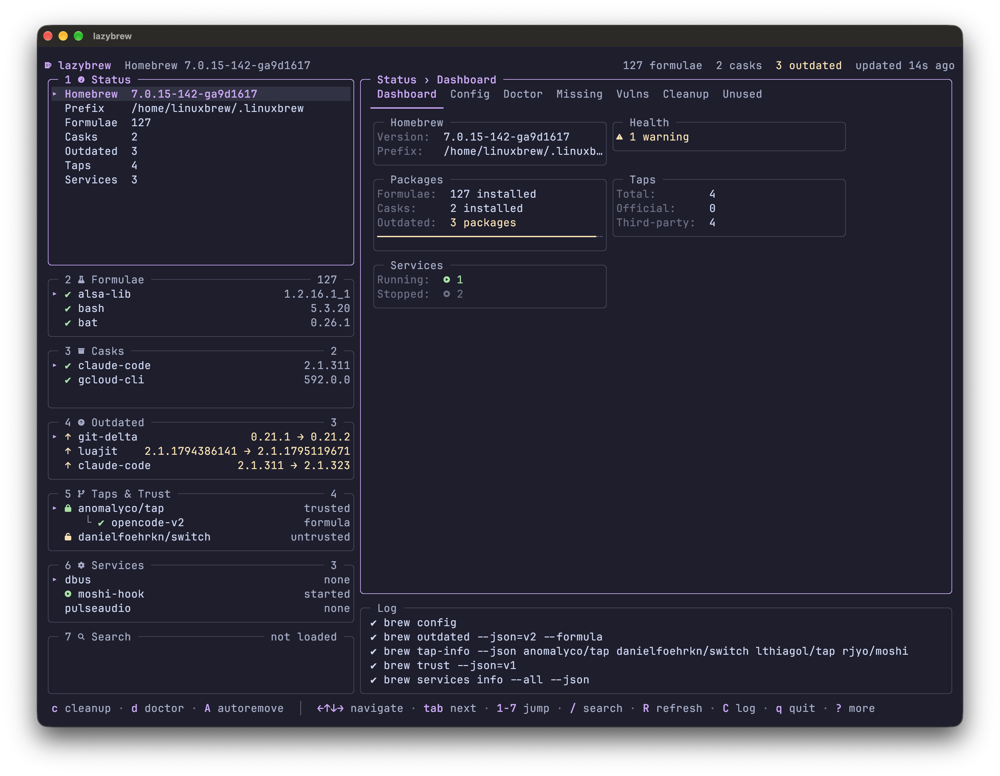
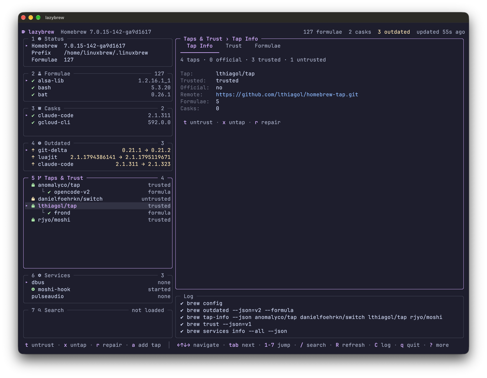
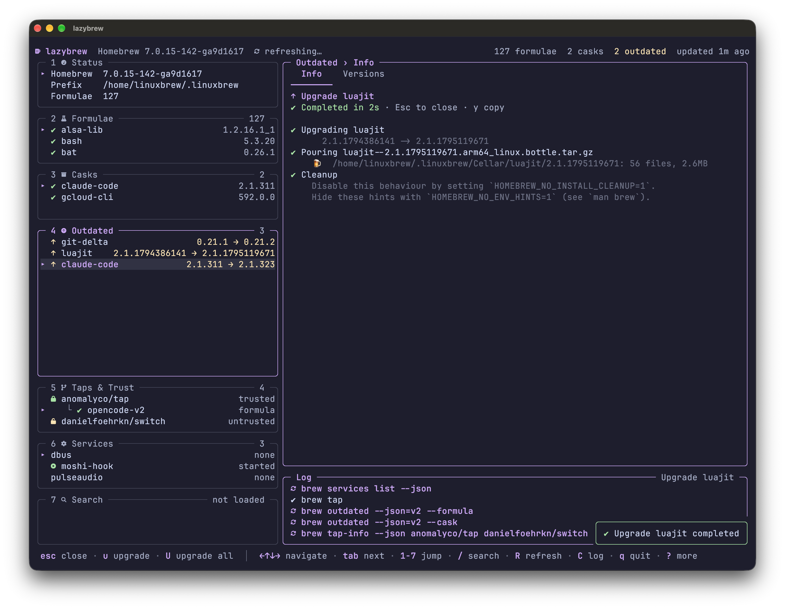

# lazybrew

A terminal UI for Homebrew, on macOS and Linux.



## Features

- Browse installed formulae and casks; search, install, uninstall and upgrade
- See what's outdated and upgrade it, with live command output
- Manage taps and `brew trust`
- Start and stop services
- Run doctor, cleanup, autoremove and `brew vulns` from the Status panel

## Install

**Homebrew**

```bash
brew install lthiagol/tap/lazybrew
```

**From source** (Go 1.26+)

```bash
go install github.com/lthiagol/lazybrew/cmd/lazybrew@latest
```

or

```bash
git clone https://github.com/lthiagol/lazybrew
cd lazybrew
make build   # bin/lazybrew
```

## Usage

```bash
lazybrew
```

Press `?` for every key.

## Config

Optional, at `~/.config/lazybrew/config.yml`. `lazybrew --config-create` writes a
commented sample there; `lazybrew --help` lists the flags.

## Requirements

- macOS or Linux
- Homebrew 6.0+ (for `brew trust`)

## Screenshots




## Contributing

See [AGENTS.md](AGENTS.md) and [DESIGN.md](DESIGN.md).

## License

[MIT](LICENSE)
